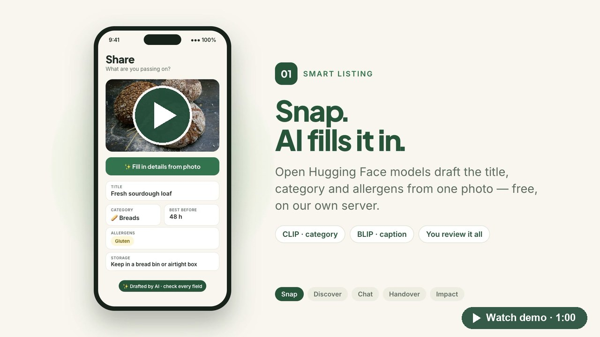

<div align="center">


# EcoShare

**Share food and things with your neighbours.**

A neighbourhood sharing app that keeps good food and household items out of the bin. List an item from a photo with AI, find what's nearby, and hand it over safely, for free or for community credits.

[](https://github.com/adriennie/Ecoshare-App/actions/workflows/ci.yml)
[](https://github.com/adriennie/Ecoshare-App/actions/workflows/mlops.yml)


[**▶ Watch the demo**](https://youtu.be/TNaDs7s6ITM) · [Features](#features) · [Architecture](#architecture) · [Getting started](#getting-started) · [AI & MLOps](#ai-features) · [API](#api-overview)

</div>

---

## Demo

<div align="center">

<a href="https://youtu.be/TNaDs7s6ITM" title="Watch the EcoShare demo on YouTube">
  
</a>

<sub>▶ <a href="https://youtu.be/TNaDs7s6ITM"><b>Watch on YouTube</b></a> (1 minute): the problem, then every feature shown on the phone with an explanation alongside it.</sub>

</div>

## The problem

Every day, perfectly good food and household items get thrown away, while a neighbour two streets away could have used them. They simply never find each other. EcoShare closes that gap: it makes passing something on as easy as taking a photo, and it makes the handover trustworthy.

## Features

| | Feature | How it works |
|---|---|---|
| 📸 | **Snap, and AI fills it in** | A photo becomes a draft listing (title, category, allergens, storage tip, shelf life). Open Hugging Face models do the drafting: CLIP picks the category and BLIP writes the caption. They can run free on your own server, and you review every field. |
| 📍 | **"For you", nearby** | The feed is ranked by your interests, distance and freshness. Candidates come from pgvector similarity, then a learned ranker orders them, with a heuristic fallback. "Similar nearby" appears on every listing. |
| 💬 | **Request & chat** | One tap requests an item. Chat is realtime (Supabase Realtime), and every message is screened for abuse (toxic-bert); flagged messages are held for review. |
| 🔐 | **Safe handover** | A one-time 6-digit pickup code confirms every exchange. Only its bcrypt hash is stored, and it expires and locks after 5 attempts. Credits move only when the code is accepted: no code, no payment. |
| 🪙 | **Community credits** | Each item is free or priced in credits. Credits live in an append-only double-entry ledger, with holds at accept time and idempotent settlement. |
| 🌳 | **Impact & badges** | Track the kg CO₂e you've helped avoid and the waste diverted, unlock badges, and grow your EcoTree with every exchange. |
| 🛡️ | **Trust & safety** | Moderation of listings and images, food-safety rules (expired food, unsafe food age), reports, blocking, and an admin moderation queue. |

## Tech stack

| Layer | Technology | Folder |
|---|---|---|
| Mobile & web app | Expo SDK 58, React Native, Expo Router, TypeScript, Reanimated | [`frontend/`](frontend) |
| API | Node 20+, Express 5, zod, pino, helmet, rate limiting | [`backend/`](backend) |
| Data, auth, storage, realtime | Supabase: Postgres 17, RLS, pgvector, Storage, Realtime | [`supabase/`](supabase) |
| AI / ML | Python 3.11, FastAPI, Hugging Face (hosted or local), PyTorch, scikit-learn, LightGBM, MLflow | [`ml-service/`](ml-service) |
| Delivery | Docker Compose, GitHub Actions (CI, weekly MLOps, gitleaks) | [`.github/workflows/`](.github/workflows) |

## Architecture

```
Expo app ──(Supabase Auth session)──► Supabase Auth
   │  reads via RLS + Realtime (messages, orders, notifications)
   │  uploads photos to storage/<uid>/...
   ▼
backend (Express) ── verifies the JWT on every request ──► Postgres RPCs (business rules, transactions)
   │                                                     ▲
   └── ml-service (FastAPI, holds HF_API_TOKEN) ─────────┘  (backend logs every prediction to ml_predictions)
          └── Hugging Face models: hosted Inference Providers or local (CLIP, BLIP, toxic-bert, NSFW, MiniLM)
```

**Principles**

- **One identity authority.** Supabase Auth issues every identity. The backend takes the user only from the verified access token, never from a request body, and its strict schemas reject client-supplied identity fields.
- **Business rules live in the database.** Requesting, accepting, pickup codes, settlement, transfers and expiry are `SECURITY DEFINER` Postgres functions ([`supabase/migrations/*_functions.sql`](supabase/migrations)). They lock rows, run each operation in one transaction, and read the caller from `auth.uid()`.
- **Default-deny RLS.** Clients read only what policies allow, and no client can write credits, orders, listings or messages directly.

<details>
<summary><b>Exchange lifecycle</b></summary>

```
requested ─► accepted ─► ready_for_pickup ─► completed
    │            │               │               │
    ▼            ▼               ▼               ▼
declined    cancelled/expired  cancelled/expired/disputed  disputed
```

1. **Request.** Owners can't request their own items, and a requester can have only one open request per item.
2. **Accept.** The listing row is locked and reserved; a unique index allows one reservation per listing. The price and fee are copied onto the order, the requester's credits move into a hold, and every other request is declined.
3. **Ready for pickup.** The requester taps "Show pickup code". This issues a cryptographically random 6-digit code. Only a bcrypt hash is stored, the code expires after 30 minutes, and it allows 5 attempts.
4. **Complete.** The owner enters the code, and `complete_exchange` verifies it and settles in a single transaction:
   - the hold is released;
   - balanced ledger entries are written (buyer −total, seller +price, platform +fee);
   - a unique `settlements` row is written.

   The call takes an **idempotency key**, so retries never charge twice.
5. **Expiry.** A background job expires stale requests and reservations (releasing their holds) and archives expired food.

</details>

<details>
<summary><b>Credits</b></summary>

- Credits are whole numbers.
- `credit_ledger` is append-only and double-entry. Triggers block updates and deletes, even for privileged roles.
- `wallets.balance` is maintained by a trigger, with `CHECK (balance >= 0)`. Holds are tracked separately, with `held <= balance`.
- The `wallet_reconciliation` view must always be empty; the background job logs an alert if it isn't.
- New users get a **100-credit** welcome bonus (`app_config.signup_bonus_credits`), one per user.
- The platform fee is `ceil(2% of price)`, paid by the requester.
- Credits have no cash value.

</details>

## AI features

All model calls go through `ml-service`, the only component that holds `HF_API_TOKEN`. Every call has a timeout and a fallback, so the app keeps working when AI is unavailable.

| Feature | Models (configurable in [`ml-service/app/config.py`](ml-service/app/config.py)) | Fallback |
|---|---|---|
| **Smart listing** | Hosted VLM `Qwen/Qwen2.5-VL-7B-Instruct` with the versioned prompt `prompts/listing_suggest.v1.yaml`, or free local CLIP + BLIP-large | BLIP caption + `facebook/bart-large-mnli` zero-shot |
| **Recommendations** | `sentence-transformers/all-MiniLM-L6-v2` embeddings in pgvector + an in-house gradient-boosted ranker | Heuristic: similarity, distance, freshness, popularity, urgency |
| **Trust & safety** | `unitary/toxic-bert`, `Falconsai/nsfw_image_detection`, deterministic food-safety rules | Rules only |
| **Reliability** | Calibrated logistic regression for P(exchange completes), shown as a badge and never used to block anyone | Beta prior from the user's own history |
| **Impact** | Versioned emission-factor table ([`impact_factors.v1.json`](ml-service/app/impact_factors.v1.json)) + weight parsing | Job retries |

**Free mode (no Inference credits).** Install `requirements-local.txt` and ml-service runs open Hugging Face models on your own machine (Apple GPU via MPS, CUDA, or CPU).

| `HF_MODE` | Behaviour |
|---|---|
| `auto` (default) | Uses the hosted API, and switches to local models for an hour after a 402/401 |
| `local` | Never calls the hosted API |
| `api` | Hosted API only |

Download the weights once (about 3 GB) with `python -m app.local_models --download`. On an Apple-silicon Mac, a photo takes about 1 s after warm-up, and CLIP picked the right category for 14 of 14 demo photos.

**Moderation thresholds**

| Content | Score | Result |
|---|---|---|
| Message | toxicity ≥ 0.93 | Blocked |
| Message | toxicity ≥ 0.80 | Held behind "tap to view", and a report is filed |
| Listing | score ≥ 0.80 | Set to `pending_review` and added to the admin queue |

## MLOps

| Stage | Where |
|---|---|
| Event logging: impressions with the features served, views, saves, dismisses, requests, completions | `interactions` table, `POST /api/events`, [`backend/src/routes/feed.js`](backend/src/routes/feed.js) |
| Prediction logging: model, version, prompt version, latency, fallback, input hash | `ml_predictions` table, [`backend/src/services/predictions.js`](backend/src/services/predictions.js) |
| One feature contract shared by training and serving, to prevent skew | [`ml-service/app/features.py`](ml-service/app/features.py) |
| Versioned feature snapshots: parquet + a manifest with the data hash | `pipelines/build_features.py` |
| Training with experiment tracking and a model registry | `pipelines/train_ranker.py`, `train_risk.py` → MLflow `@challenger` |
| Promotion gate: the challenger must beat both the champion and the non-ML baseline on an out-of-time holdout | `pipelines/evaluate.py` → `@production`, hot-reloaded via `/admin/reload` |
| Prompt and model evals (offline in CI, live with HF) | `evals/run_evals.py`, `evals/thresholds.yaml` |
| Drift monitoring: PSI per feature, and the job fails on an alert | `pipelines/drift_report.py`, weekly [`mlops.yml`](.github/workflows/mlops.yml) |
| Serving metrics (Prometheus: latency, errors, fallback rate, score distribution) | `GET /metrics` on ml-service |

Until real interaction data exists, the heuristic ranker and the prior serve traffic. `make pipeline-synthetic` exercises the whole loop on synthetic data.

## Getting started

### Prerequisites

- Node 20+ and npm
- Python 3.11 and [uv](https://docs.astral.sh/uv/)
- A Supabase project, or Docker for `supabase start`
- The Expo Go app (SDK 58) on your phone, or an iOS or Android simulator
- Optional: a Hugging Face token. It isn't needed in free local mode.

### 1. Database

```bash
# Hosted project
npx supabase link --project-ref <your-ref>
npx supabase db push

# …or local (Docker)
npx supabase start
npx supabase db reset   # applies the migrations + seed.sql
```

Then, in the Supabase Auth settings:
- Enable email confirmations.
- Add the redirect URLs `ecoshare://**` and `exp://**`.
- Optionally, enable Google sign-in.

### 2. ML service

```bash
cd ml-service
cp .env.example .env          # optional: add HF_API_TOKEN, or set HF_MODE=local
make install && make test
make serve                    # http://localhost:8000
# free local models: VIRTUAL_ENV=.venv uv pip install -r requirements-local.txt
```

### 3. Backend

```bash
cd backend
cp .env.example .env          # Supabase URL + keys, ML_SERVICE_TOKEN
npm install && npm test
npm run dev                   # http://localhost:3000
```

### 4. App

```bash
cd frontend
cp .env.example .env          # EXPO_PUBLIC_API_URL → backend (use your LAN IP on a phone)
npm install
npx expo start                # scan the QR code with Expo Go
```

Or run the API and the ML service together with `docker compose up --build`. Add `--profile mlops` to also start the MLflow UI on `:5001`.

### Demo data (dev/staging only)

```bash
ml-service/.venv/bin/python scripts/seed_demo.py --region lugano   # or gurugram
ml-service/.venv/bin/python scripts/seed_demo.py --more            # add a fresh batch
```

This creates 12 fictional demo neighbours per region, about 100 photo listings, and exchange history driven through the real RPCs. The demo accounts use `@demo.ecoshare.test` addresses with the password `ecoshare-demo`.

## Tests

| Command | What it proves |
|---|---|
| `cd backend && npm test` | Real migrations on embedded Postgres (PGlite), plus HTTP tests. See below. |
| `cd ml-service && make test && make eval` | HF client fallbacks (including out-of-credits → local), the feature contract, the train → gate → export → serve round trip, PSI drift, and prompt-parsing evals. |
| `cd frontend && npm run typecheck && npm test` | Types, the API client, and listing validation. |

The backend database tests check:
- RLS isolation: a user can't edit another user's listing, read someone else's chat, mint credits, or make themselves admin.
- Reservations, pickup-code expiry and lockout, atomic settlement, idempotent retries, holds, and transfers.

The HTTP tests check that auth is required, identity comes only from the token, validation, moderation, and the ML fallbacks.

[CI](.github/workflows/ci.yml) runs all of the above, plus the synthetic MLOps loop, an Expo web build and a gitleaks secret scan.

> PGlite is single-connection. Row locking under real concurrency (`FOR UPDATE` + unique indexes) is exercised only against real Postgres (`supabase start`).

## API overview

All routes are under `/api` and return errors as `{ error: { code, message } }`.

| Area | Endpoints |
|---|---|
| Profile | `GET/PATCH/DELETE /me` |
| Listings | `GET /categories`, `GET /listings` (search, filters, pagination), `GET /listings/:id`, `POST /listings`, `PATCH/DELETE /listings/:id`, `POST/DELETE /listings/:id/save`, `GET /saved`, `GET /listings/mine` |
| Feed | `GET /feed` |
| Exchanges | `GET /orders`, `GET /orders/:id`, `POST /orders`, `POST /orders/:id/{respond,ready,pickup-code,complete,cancel,dispute}` |
| Chat | `GET/POST /chats`, `GET /chats/:id`, `GET/POST /chats/:id/messages`, `POST /chats/:id/read` |
| Credits | `GET /credits/wallet`, `GET /credits/ledger`, `POST /credits/transfer` |
| Other | `GET /notifications`, `POST /notifications/:id/read`, `POST /reports`, `POST/DELETE /blocks`, `POST /events`, `POST /ai/listing-suggest`, `GET /impact/{me,community}` |
| Admin | `GET /admin/reports`, `POST /admin/reports/:id/resolve`, `POST /admin/orders/:id/resolve-dispute` |

## Project structure

```
Ecoshare-App/
├── frontend/          Expo app: app/ (routes), components/, features/, lib/
├── backend/           Express API: src/{routes,services,middleware,db}, tests/{db,http}
├── supabase/          migrations/ (schema, RPCs, RLS, storage), seed.sql, tests/
├── ml-service/        FastAPI: app/, pipelines/, evals/, tests/, prompts/
├── scripts/           seed_demo.py (demo neighbourhoods)
├── docs/assets/       README images
├── docker-compose.yml
└── .github/workflows/ ci.yml, mlops.yml
```

## Security

- Secrets are loaded only from `.env` files, which are git-ignored. Every package ships an `.env.example`.
- The service-role key is used only by the backend and the ML jobs, never by the app.
- Earlier commits contained a Supabase service-role key. If you forked before the overhaul, **roll the service-role key and the JWT secret** in the Supabase dashboard. Removing a key from the code doesn't remove it from git history.
- Please report vulnerabilities privately to the maintainers rather than in a public issue.

<div align="center">

<sub>Built to keep good stuff in use. 🌱</sub>

</div>
